# Лабораторная работа №2. Трекинг объекта по ключевым точкам

**Цель:** реализовать простейший алгоритм трекинга объекта на видео на основе ключевых точек.

**Задача:** первый кадр видео — крупное изображение плоского объекта. На каждом следующем кадре, где объект виден, нужно нарисовать вокруг него рамку с подписью, как можно точнее повторяющую его границы.

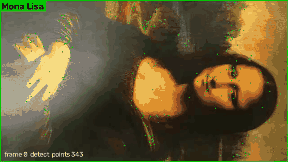

## 1. Теоретическая база

**Ключевые точки и дескрипторы.** Ключевая точка — характерное место изображения (угол, пятно), которое можно снова найти на другом снимке того же объекта. Дескриптор — вектор, описывающий окрестность точки. Похожие окрестности дают близкие дескрипторы.

* **SIFT** [1] ищет экстремумы разности гауссиан (DoG) в пространстве масштабов, поэтому точки находятся на любом масштабе. Ориентацию точки задаёт преобладающее направление градиента. Дескриптор — 128 чисел: гистограммы направлений градиента в сетке 4×4 вокруг точки. Поэтому SIFT инвариантен к масштабу, повороту и изменению яркости и устойчив к небольшим изменениям ракурса.
* **ORB** [2] — быстрая альтернатива: детектор FAST с ориентацией по моменту яркости и бинарный дескриптор BRIEF длиной 256 бит. Дескрипторы сравниваются по расстоянию Хэмминга.

**Сопоставление.** Для каждого дескриптора шаблона ищутся два ближайших в кадре (для SIFT — приближённым поиском FLANN по kd-деревьям [3]). Пара принимается по **тесту отношения Лоу** [1]: $d_1 < 0.75\, d_2$. Соответствие должно быть заметно лучше второго варианта, иначе оно неоднозначно.

**Гомография.** Изображения плоского объекта, снятого с двух ракурсов, связаны проективным преобразованием:

$$\begin{pmatrix} x' \\ y' \\ 1 \end{pmatrix} \sim H \begin{pmatrix} x \\ y \\ 1 \end{pmatrix}, \quad H \in \mathbb{R}^{3 \times 3},$$

у $H$ 8 степеней свободы, для её вычисления достаточно 4 пар точек (DLT). Если известна $H$ между шаблоном и кадром, углы шаблона переносятся в кадр, и получается рамка-четырёхугольник, которая повторяет перспективу объекта, а не просто прямоугольник.

**RANSAC** [5] отсеивает ложные соответствия. Он многократно берёт 4 случайные пары, строит по ним $H$ и считает **inliers** — пары, у которых ошибка репроекции меньше порога (здесь 3 px). Выбирается гипотеза с наибольшим числом inliers, затем $H$ уточняется по всем inliers.

**Оптический поток Лукаса–Канаде** [6, 7]. Предполагается, что яркость точки между соседними кадрами не меняется, а смещение мало и одинаково в окне вокруг точки. Тогда смещение $(u, v)$ находится из системы $\sum (I_x u + I_y v + I_t)^2 \to \min$ по окну. Пирамидальная версия [7] решает задачу от грубого масштаба к точному и поэтому справляется с большими смещениями. Точки для слежения выбираются детектором Ши–Томази [8] (минимальное собственное число матрицы вторых моментов). Надёжность проверяется **ошибкой вперёд-назад** [9]: точку отслеживают в следующий кадр и обратно. Если она не вернулась на место (ошибка > 2 px), трек считается сломанным.

**Детекция и трекинг.** Детекция по ключевым точкам не накапливает ошибку: каждый кадр сравнивается с исходным шаблоном. Но когда объект мал или размыт, совпадений не хватает. Оптический поток работает и на маленьком, и на размытом объекте, но ошибка постепенно копится (дрейф). Поэтому обычно их комбинируют: поток ведёт объект между кадрами, а детекция при каждой возможности сбрасывает накопленный дрейф (схема tracking-by-detection, как в TLD [9]).

## 2. Описание системы

| Файл | Что делает |
|---|---|
| [tracker.py](tracker.py) | `KeypointTracker` — алгоритм трекинга, `draw` — отрисовка рамки и подписи |
| [track.py](track.py) | CLI: обрабатывает видео и сохраняет результат в `.mp4` |
| [params.py](params.py) | меняет параметры по одному и строит график их влияния |
| [experiments.py](experiments.py) | прогоняет все видео и конфигурации, считает метрики, строит графики и кадры в `results/` |
| [videos/](videos/) | тестовые видео и образец `simple_track.avi` |

### Алгоритм

**Инициализация.** Первый кадр — шаблон (весь кадр или заданная область `roi`). По нему считаются ключевые точки SIFT и дескрипторы, рамка — углы кадра. Гомография $H = I$. Внутри рамки выбираются до 200 точек Ши–Томази для оптического потока. Для каждой точки запоминается её «якорь» — координаты в системе шаблона $H^{-1} p$.

**Каждый кадр** (`KeypointTracker.update`):

```
             ┌──────────────────────┐
  кадр ────► │ детекция: SIFT, FLANN│── ≥15 inliers и ──► режим detect: H из детекции,
             │ ratio test, RANSAC   │   рамка корректна    точки потока пересеиваются
             └──────────┬───────────┘
                        │ не нашли
             ┌──────────▼───────────┐
             │ трекинг: LK пред.→тек│── ≥8 точек и ──────► режим flow: H по якорям
             │ + проверка вперёд-   │   рамка корректна    точек (шаблон → кадр)
             │ назад, RANSAC        │
             └──────────┬───────────┘
                        │ не вышло
             ┌──────────▼───────────┐
             │ удержание ≤ 5 кадров │────────────────────► режим hold: рамка на месте,
             └──────────┬───────────┘                      точки сеются заново
                        ▼
                   режим lost: рамки нет
```

1. **Детекция.** SIFT на кадре → `knnMatch` (k = 2) с дескрипторами шаблона → тест Лоу 0.75 → `findHomography(RANSAC, 3 px)`. Результат принимается, если inliers ≥ 15 и рамка корректна: четырёхугольник выпуклый, площадь ≥ 400 px², отношение длинной стороны к короткой < 6. Иначе RANSAC мог подогнать $H$ под случайные совпадения, и рамка вырождается.
2. **Трекинг.** Если детекция не удалась, точки предыдущего кадра отслеживаются пирамидальным LK (окно 21×21, 5 уровней) с проверкой вперёд-назад. Гомография считается **напрямую от якорей шаблона к текущим позициям**, а не как произведение межкадровых гомографий. Ошибки отдельных точек отсекаются RANSAC и не перемножаются из кадра в кадр. Если точек осталось меньше половины, внутри рамки выбираются новые.
3. **Удержание (hold).** На переходе «резкий кадр → сильно смазанный» LK ломается (ошибка вперёд-назад — сотни пикселей), хотя между двумя смазанными кадрами работает. Поэтому до 5 кадров рамка остаётся на месте, а точки сеются заново уже на смазанном кадре. На следующем кадре поток подхватывает объект.
4. **Отрисовка.** Четырёхугольник по углам $H \cdot$ (углы шаблона) и подпись над верхней вершиной. Цвет показывает режим: зелёный — detect, жёлтый — flow, красный — hold. Точки — inliers текущего режима. Внизу кадра выводятся номер кадра, режим и число точек.

### Ключевая реализация

Всё ядро — класс `KeypointTracker` в [tracker.py](tracker.py), около 120 строк. Ниже — главные места.

**1. Шаблон: ключевые точки только внутри объекта, рамка — углы шаблона** ([tracker.py:42-50](tracker.py#L42-L50)):

```python
x, y, w, h = roi or (0, 0, gray.shape[1], gray.shape[0])
self.corners = np.float32([[x, y], [x + w, y], [x + w, y + h], [x, y + h]]).reshape(-1, 1, 2)
mask = np.zeros_like(gray)
mask[y:y + h, x:x + w] = 255
kp, self.desc = self.detector.detectAndCompute(gray, mask)
self.H = np.eye(3)          # на первом кадре объект там же, где шаблон
```

**2. Детекция: сопоставление + тест Лоу + RANSAC + проверка рамки** ([tracker.py:62-75](tracker.py#L62-L75)):

```python
pairs = self.matcher.knnMatch(self.desc, desc, k=2)
good = [p[0] for p in pairs if len(p) == 2 and p[0].distance < self.ratio * p[1].distance]
src = self.template_pts[[m.queryIdx for m in good]]          # точки в шаблоне
dst = np.float32([kp[m.trainIdx].pt for m in good])          # те же точки в кадре
H, mask = cv2.findHomography(src, dst, cv2.RANSAC, self.ransac_thresh)
if H is None or mask.sum() < self.min_inliers or not self.is_valid(H):
  return None
```

`is_valid` отбрасывает вырожденные гомографии: рамка должна быть выпуклой, не крошечной и не вытянутой в «иглу».

**3. Оптический поток с проверкой вперёд-назад и якорями** ([tracker.py:84-99](tracker.py#L84-L99)):

```python
nxt, st, _ = cv2.calcOpticalFlowPyrLK(self.prev, gray, self.points, None, **LK_PARAMS)
back, st_back, _ = cv2.calcOpticalFlowPyrLK(gray, self.prev, nxt, None, **LK_PARAMS)
fb_error = np.linalg.norm(self.points - back, axis=2).ravel()
ok = (st.ravel() == 1) & (st_back.ravel() == 1) & (fb_error < self.fb_thresh)
H, mask = cv2.findHomography(self.anchors[ok], nxt[ok], cv2.RANSAC, self.ransac_thresh)
```

Главное здесь — `self.anchors`: у каждой отслеживаемой точки хранится её положение **в шаблоне**. Гомография каждый раз считается «шаблон → текущий кадр», а не перемножается из межкадровых `H_t = ΔH · H_{t-1}`. Поэтому ошибка одного кадра не умножается на все следующие. Якоря задаются при посеве точек ([tracker.py:77-82](tracker.py#L77-L82)): `anchors = H⁻¹ · points`.

**4. Выбор режима** ([tracker.py:101-121](tracker.py#L101-L121)):

```python
mode, result = 'detect', self.detect(gray)
if result is None and self.use_flow:
  mode, result = 'flow', self.track(gray)
if result is None and self.use_flow and self.H is not None and self.misses < self.max_hold:
  ...  # hold: рамка остаётся, точки сеются заново на текущем кадре
elif result is None:
  ...  # lost
else:
  self.H, points = result
  if mode == 'detect' or len(self.points) < self.max_points // 2:
    self.seed_points(gray)   # после детекции дрейф сброшен — пересеваем точки
```

Порядок важен: сначала детекция. Она не накапливает ошибку, и каждое её срабатывание обнуляет дрейф потока.

**5. Рамка на кадре** — просто проекция углов шаблона: `cv2.perspectiveTransform(self.corners, H)`. Поэтому рамка — не прямоугольник, а четырёхугольник с перспективой объекта.

### Запуск

```bash
uv sync
# одно видео: результат в videos/<имя>_tracked.mp4 (или -o), --show — показывать окно
uv run python Lab2/track.py Lab2/videos/mona-lisa.avi --label "Mona Lisa"
# все эксперименты и картинки для отчёта
uv run python Lab2/experiments.py
```

Опции `track.py`: `--roi x,y,w,h` — область объекта на первом кадре (по умолчанию весь кадр), `--detector sift|orb`, `--no-flow` (только детекция).

## 3. Результаты

Машина: Apple M4, Python 3.14, OpenCV 5.0. Видео 640×360, 558 кадров, 30 кадр/с. Полные видео с рамкой: [mona-lisa](results/mona-lisa_tracked.mp4), [mona-lisa-blur](results/mona-lisa-blur_tracked.mp4), [mona-lisa-blur-extra-credit](results/mona-lisa-blur-extra-credit_tracked.mp4).

Рамка охватывает не весь лист, а только часть картины. Так и должно быть: объектом считается то, что видно на первом кадре, а на нём картина обрезана.

### Тестовые видео

**mona-lisa.avi**


**mona-lisa-blur.avi** — на кадрах 10–28 сильное размытие движением.

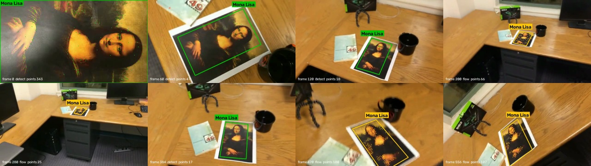
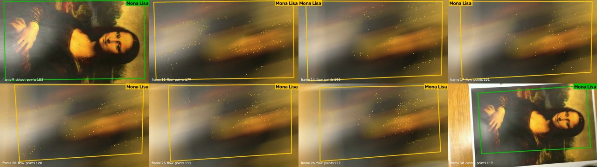

**mona-lisa-blur-extra-credit.avi** — размыты кадры 11–29 и 391–399.

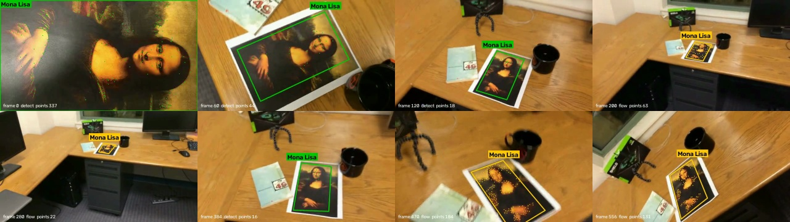
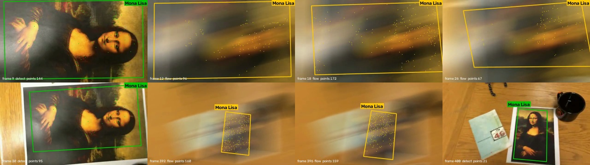

| Видео | Кадров | detect | flow | hold | lost | Рамка есть | IoU с эталоном | кадр/с |
|---|---|---|---|---|---|---|---|---|
| mona-lisa | 558 | 194 | 364 | 0 | 0 | 100% | — | 57 |
| mona-lisa-blur | 558 | 175 | 382 | 1 | 0 | 100% | 0.935 | 59 |
| mona-lisa-blur-extra-credit | 558 | 166 | 390 | 2 | 0 | 100% | 0.937 | 60 |

**Как считается IoU.** Размытые видео — это то же видео `mona-lisa.avi`, в котором часть кадров смазана. Остальные кадры попиксельно те же. Поэтому за эталон взяты рамки, найденные на резком видео, и для каждого кадра считается IoU (площадь пересечения / площадь объединения) рамок. Это не ручная разметка: на дальнем участке эталон сам получен оптическим потоком. Метрика показывает устойчивость к размытию, а не абсолютную точность.

Режимы по кадрам и число точек (inliers для detect, отслеживаемые точки для flow):

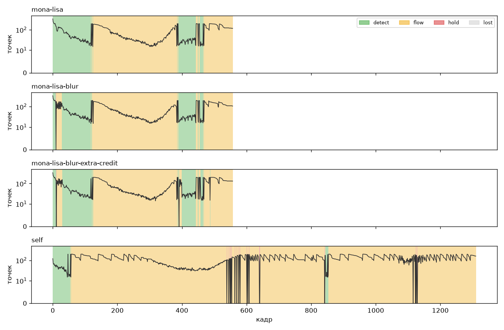

* Кадры 0–118 и 384–445: картина близко, SIFT находит её каждый кадр (от 300 inliers на первом кадре до ~20 на ~120-м).
* Кадры 125–383: картина далеко, около 120×70 px. Глобальная детекция почти не находит соответствий: у такой маленькой картинки мало отличимых SIFT-точек, а шаблон снят в 5 раз крупнее. Объект ведёт оптический поток. Когда камера снова приближается (кадр 384), детекция сразу перехватывает объект.
* На размытых кадрах детекция не работает. Срабатывает hold (1–2 кадра), дальше рамку ведёт поток.

### Сравнение конфигураций

Ячейка: доля кадров с рамкой / средний IoU с эталоном (рамки SIFT + LK на `mona-lisa.avi`).

| Конфигурация | mona-lisa | mona-lisa-blur | mona-lisa-blur-extra-credit | кадр/с |
|---|---|---|---|---|
| SIFT (только детекция) | 35% / 0.35 | 31% / 0.31 | 30% / 0.29 | 64 |
| **SIFT + LK** | 100% / 1.00 | 100% / 0.94 | 100% / 0.94 | 59 |
| ORB (только детекция) | 32% / 0.30 | 29% / 0.26 | 27% / 0.25 | 256 |
| ORB + LK | 100% / 0.85 | 100% / 0.84 | 100% / 0.90 | 189 |

IoU только на размытых кадрах (28 и 19 кадров):

| Конфигурация | mona-lisa-blur | mona-lisa-blur-extra-credit |
|---|---|---|
| SIFT | 0.000 | 0.036 |
| **SIFT + LK** | 0.884 | 0.909 |
| ORB | 0.000 | 0.035 |
| ORB + LK | 0.909 | 0.842 |

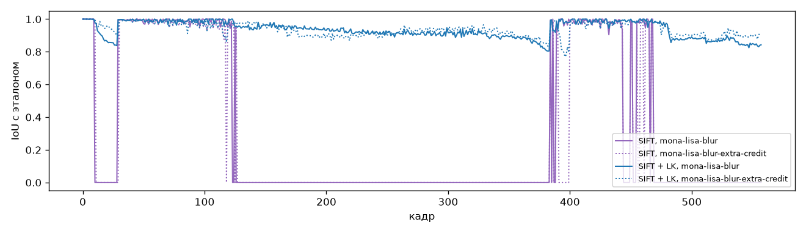

* Одна детекция находит объект только на крупных планах, около трети кадров. На размытых кадрах она не находит ничего.
* Оптический поток даёт рамку на 100% кадров, в том числе на размытых (IoU ≈ 0.9).
* ORB в 4 раза быстрее SIFT, но его рамки менее точны: IoU 0.85 против эталона на том же резком видео. ORB находит меньше inliers на средних масштабах, поэтому чаще срабатывает поток и чаще возникает дрейф.

### Дрейф оптического потока

Трекер запущен только на оптическом потоке (детекция лишь на первом кадре). На кадрах, где SIFT уверенно находит объект (≥ 30 inliers), считается среднее отклонение углов рамки потока от углов детекции:

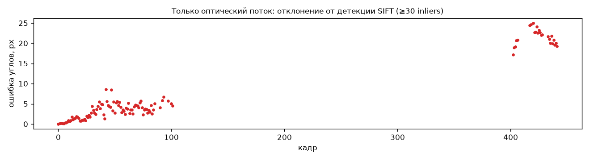

Через 80 кадров ошибка — около 3–4 px. После ~420 кадров, включая дальний участок, — около 23 px при размере объекта ~170 px. Поток без детекции постепенно уплывает, поэтому детекция на каждом кадре нужна: она сбрасывает дрейф.

### Сравнение с образцом

Сверху — образец `simple_track.avi` из задания, снизу — наш результат на тех же кадрах (139, 200, 278, 417):

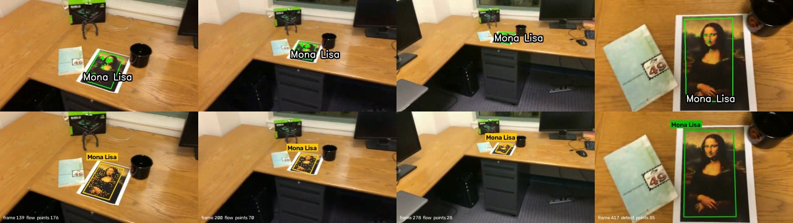

На дальнем плане (кадр 278) рамка образца стягивается в маленький неверный четырёхугольник. У нас рамка остаётся на объекте, потому что дальний участок ведёт оптический поток.

### Своё видео

Объект — кожаный кошелёк на столе, `videos/self.mp4`: телефон, 720×1280, 60 кадр/с, 1311 кадров (22 с). Камера отходит от кошелька, обходит стол, снова приближается, наклоняется. Полное видео с рамкой: [self_tracked.mp4](results/self_tracked.mp4).

На первом кадре кошелёк занимает не весь кадр, вокруг него стол. Если взять весь кадр как шаблон, трекер следит за плоскостью стола, а не за кошельком. Поэтому на первом кадре задана область объекта (`--roi 90,278,541,749`, получена порогом Оцу по тёмному кошельку на светлом столе). Ключевые точки шаблона берутся только из неё, а углы рамки — её углы.

```bash
uv run python Lab2/track.py Lab2/videos/self.mp4 --label Wallet --roi 90,278,541,749
```

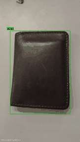

Кадры 0, 119, 238, …, 1310:

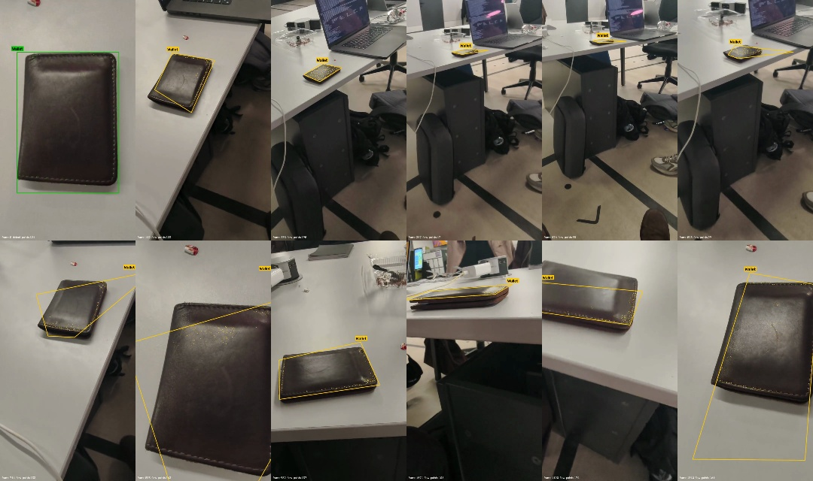

| Видео | Кадров | detect | flow | hold | lost | Рамка есть | кадр/с |
|---|---|---|---|---|---|---|---|
| self | 1311 | 63 | 1228 | 20 | 0 | 100% | 29 |

* **Мало ключевых точек.** Кошелёк — гладкая тёмная кожа почти без текстуры, только строчка по краю и блики. SIFT находит объект лишь на 63 кадрах из 1311, в основном в начале. Почти всё видео объект ведёт оптический поток (по точкам строчки и края).
* **Хорошие участки.** Отход камеры, дальний план, обход стола (кадры 119–600) и наклонный ракурс (952–1190): рамка лежит на кошельке.
* **Ошибки.** При резком приближении (кадры ~700–850) и в конце видео рамка искажается и вылезает за объект. Поток ведёт точки в основном по краю, гомография по ним плохо обусловлена, а детекция, которая сбросила бы дрейф, не срабатывает: не хватает текстуры.
* **Скорость.** Видео обрабатывается со скоростью 29 кадр/с: кадр в 4 раза больше тестового (720×1280).

Это подтверждает замечание из задания: для трекинга по ключевым точкам нужен объект с богатой текстурой. Обложка книги или коробка с рисунком дала бы детекцию на большей части кадров.

### Влияние параметров

[params.py](params.py) меняет по одному параметру (остальные по умолчанию) и прогоняет `mona-lisa-blur-extra-credit.avi`. IoU считается с эталоном (резкое видео), отдельно по всем кадрам и только по 28 смазанным. RANSAC и FLANN случайные, поэтому одинаковые настройки дают разброс около ±0.02 IoU между запусками: различия меньше этого — шум.

```bash
uv run python Lab2/params.py
```

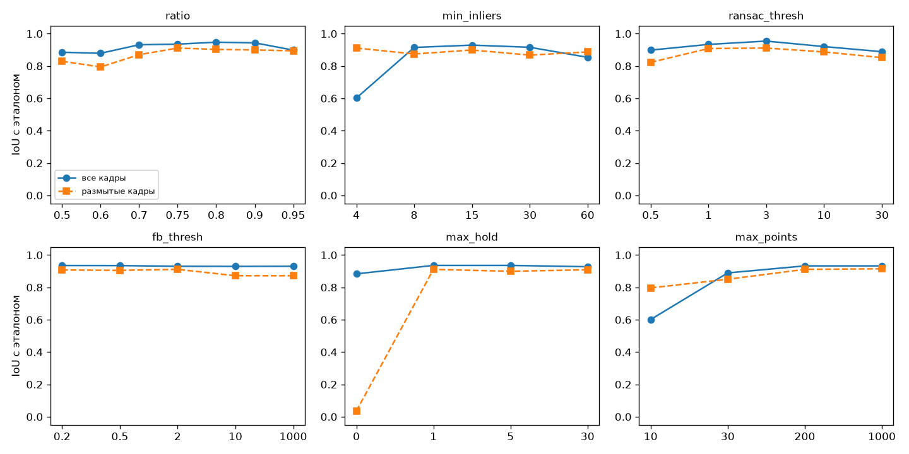

| Параметр | Значение | detect | flow | hold | lost | IoU (все) | IoU (размытые) | кадр/с |
|---|---|---|---|---|---|---|---|---|
| ratio | 0.5 | 96 | 459 | 3 | 0 | 0.885 | 0.830 | 61 |
| ratio | 0.6 | 130 | 426 | 2 | 0 | 0.879 | 0.795 | 62 |
| ratio | 0.7 | 151 | 405 | 2 | 0 | 0.932 | 0.870 | 61 |
| ratio | **0.75** | 166 | 390 | 2 | 0 | 0.936 | 0.911 | 60 |
| ratio | 0.8 | 181 | 375 | 2 | 0 | 0.947 | 0.903 | 52 |
| ratio | 0.9 | 231 | 325 | 2 | 0 | 0.944 | 0.900 | 36 |
| ratio | 0.95 | 198 | 358 | 2 | 0 | 0.899 | 0.894 | 33 |
| min_inliers | 4 | 281 | 272 | 5 | 0 | 0.602 | 0.911 | 59 |
| min_inliers | 8 | 241 | 315 | 2 | 0 | 0.915 | 0.875 | 59 |
| min_inliers | **15** | 171 | 385 | 2 | 0 | 0.929 | 0.899 | 60 |
| min_inliers | 30 | 87 | 468 | 3 | 0 | 0.916 | 0.868 | 61 |
| min_inliers | 60 | 28 | 527 | 3 | 0 | 0.854 | 0.887 | 59 |
| ransac_thresh | 0.5 | 109 | 446 | 3 | 0 | 0.899 | 0.823 | 54 |
| ransac_thresh | 1 | 155 | 401 | 2 | 0 | 0.934 | 0.909 | 58 |
| ransac_thresh | **3** | 168 | 388 | 2 | 0 | 0.954 | 0.911 | 60 |
| ransac_thresh | 10 | 167 | 389 | 2 | 0 | 0.921 | 0.887 | 60 |
| ransac_thresh | 30 | 162 | 394 | 2 | 0 | 0.889 | 0.852 | 60 |
| fb_thresh | 0.2 | 168 | 388 | 2 | 0 | 0.935 | 0.908 | 59 |
| fb_thresh | 0.5 | 169 | 387 | 2 | 0 | 0.935 | 0.905 | 59 |
| fb_thresh | **2** | 166 | 390 | 2 | 0 | 0.930 | 0.911 | 59 |
| fb_thresh | 10 | 168 | 388 | 2 | 0 | 0.930 | 0.872 | 60 |
| fb_thresh | ∞ (выкл.) | 166 | 390 | 2 | 0 | 0.930 | 0.872 | 59 |
| max_hold | 0 (выкл.) | 167 | 363 | 0 | 28 | 0.884 | 0.036 | 61 |
| max_hold | 1 | 167 | 389 | 2 | 0 | 0.936 | 0.911 | 61 |
| max_hold | **5** | 167 | 389 | 2 | 0 | 0.936 | 0.900 | 61 |
| max_hold | 30 | 169 | 387 | 2 | 0 | 0.928 | 0.909 | 61 |
| max_points | 10 | 168 | 362 | 28 | 0 | 0.601 | 0.797 | 65 |
| max_points | 30 | 169 | 387 | 2 | 0 | 0.889 | 0.850 | 64 |
| max_points | **200** | 168 | 388 | 2 | 0 | 0.933 | 0.911 | 61 |
| max_points | 1000 | 168 | 388 | 2 | 0 | 0.933 | 0.915 | 59 |

Жирным — значения по умолчанию.

* **`ratio` (тест Лоу).** Строже (0.5–0.6) — меньше совпадений: детекция срабатывает реже (96 кадров вместо 166), больше работы у потока, больше дрейф. Мягче (0.9–0.95) — совпадений больше, но среди них много ложных. RANSAC их отсеивает, но работает медленнее (33 кадр/с вместо 60), а качество при 0.95 падает. 0.75–0.8 — компромисс, как и рекомендует Лоу [1].
* **`min_inliers`.** Самый опасный параметр. При 4 (минимум для гомографии) детекция «находит» объект на 281 кадре, но многие из них — ложные: RANSAC всегда найдёт 4 точки, согласные с какой-то гомографией. IoU падает до 0.60, рамка прыгает. Проверка на чужом видео (шаблон Моны Лизы, видео с кошельком, картины в кадре нет): при `min_inliers = 4` — 13 ложных срабатываний из 655 кадров, при 8 и 15 — ни одного. Слишком большой порог (60) отключает детекцию почти везде (28 кадров), и всё держится на потоке с дрейфом.
* **`ransac_thresh`** (допустимая ошибка репроекции, px). Маленький (0.5) — даже правильные пары из-за шума координат выпадают из inliers, детекция реже проходит порог. Большой (10–30) — в inliers попадают ложные пары, гомография слегка «гуляет», IoU падает до 0.89.
* **`fb_thresh`** (проверка вперёд-назад). На резких кадрах почти не влияет: точки LK и так хорошие, а RANSAC добивает остальное. На смазанных кадрах без проверки (∞) IoU падает с 0.91 до 0.87: на смазе много точек «проскальзывает», и только эта проверка их отсекает.
* **`max_hold`.** 0 — удержания нет: на 28 смазанных кадрах рамка пропадает (lost), IoU на них 0.04. Уже 1 кадр полностью решает проблему: на следующем кадре точки посеяны заново на смазанном изображении, и поток их подхватывает. Большие значения не мешают на этих видео. Но если объект действительно ушёл из кадра, рамка будет висеть на пустом месте до `max_hold` кадров, поэтому слишком большой `max_hold` вреден.
* **`max_points`** (точек для потока). 10 — слишком мало: после фильтрации остаётся меньше 8 точек, поток не строит гомографию, срабатывает hold (28 кадров), IoU 0.60. 30 — работает, но гомография по малому числу точек шумнее. 200 и 1000 почти одинаковы: больше точек дороже, но не точнее.

### Крайние случаи

| Ситуация | Что происходит | Почему |
|---|---|---|
| Объект далеко (≈120×70 px, кадры 125–383) | детекция не находит, ведёт поток | мало отличимых SIFT-точек на маленьком объекте; шаблон в 5 раз крупнее |
| Сильное размытие движением | 1–2 кадра hold, затем поток | дескрипторы на смазе не совпадают с резким шаблоном; LK «резкий → смазанный» ломается, «смазанный → смазанный» работает |
| Поворот на 90°, наклон, перспектива | детекция работает | SIFT инвариантен к повороту и масштабу, гомография описывает перспективу |
| Объект без текстуры (кошелёк) | детекция на 5% кадров, рамка уплывает на крупных планах | ключевых точек мало, поток держится за край объекта, гомография по точкам на одной линии плохо обусловлена |
| Объект не на весь первый кадр | без `--roi` трекается весь первый кадр (стол) | шаблоном считается весь кадр; решается заданием `--roi` |
| Объекта нет в кадре | при `min_inliers ≥ 8` ложных детекций нет; рамка исчезает после `max_hold` кадров, если поток тоже сломался | RANSAC-порог и `is_valid` отсекают случайные гомографии |
| Объект уходит за край кадра | поток ведёт оставшиеся видимые точки, рамка может выходить за кадр | так и должно быть: проекция углов шаблона может лежать вне кадра |
| Долго нет детекции | дрейф: ~4 px за 80 кадров, ~23 px за 420 | ошибки LK копятся; сбрасываются при первой же детекции |
| Похожий объект рядом (повторяющаяся текстура) | тест Лоу отбрасывает неоднозначные пары | если оба соседа одинаково похожи, `d1/d2 ≈ 1` |
| Объект меняется сам (сгибается, перекрыт рукой) | inliers меньше, рамка может искажаться | модель — плоский жёсткий объект; перекрытие частично компенсирует RANSAC |

## 4. Выводы

1. Реализован трекер плоского объекта по ключевым точкам. Детекция SIFT + FLANN + тест Лоу + гомография RANSAC находит объект относительно первого кадра. Пирамидальный оптический поток Лукаса–Канаде с проверкой вперёд-назад ведёт объект там, где детекция не справляется. Рамка — проекция углов шаблона через гомографию, поэтому она повторяет перспективу объекта.
2. На всех трёх тестовых видео рамка есть на 100% кадров. На размытых кадрах средний IoU с эталоном — 0.88–0.91. Скорость — около 60 кадр/с на 640×360, то есть быстрее реального времени.
3. Одной детекции по ключевым точкам недостаточно: она работает только на крупных планах (около трети кадров). На маленьком (≈120×70 px) и смазанном объекте совпадений слишком мало.
4. Оптический поток без детекции дрейфует, на длинном отрезке — до ~15% размера объекта. Комбинация «детекция, иначе поток» сочетает сильные стороны обоих методов.
5. SIFT точнее ORB, ORB быстрее в 3–4 раза. Для такой задачи выбран SIFT: скорость и так достаточна.
6. На своём видео (кошелёк — объект почти без текстуры) рамка есть на всех кадрах, но детекция срабатывает лишь на 5% кадров. Поэтому на крупных планах и в конце рамка уплывает. Для трекинга по ключевым точкам объект должен быть текстурным.
7. Критичные параметры — `min_inliers` (меньше 8 — ложные детекции) и наличие удержания `max_hold ≥ 1` (без него рамка пропадает на смазе). Остальные (`ratio` 0.7–0.8, `ransac_thresh` 1–3 px, `max_points` ≥ 100) в разумных пределах на результат влияют слабо.
8. Чтобы точнее вести далёкий объект, можно детектировать на нескольких масштабах шаблона, уточнять гомографию прямым методом (ECC) или сглаживать рамку фильтром Калмана.
