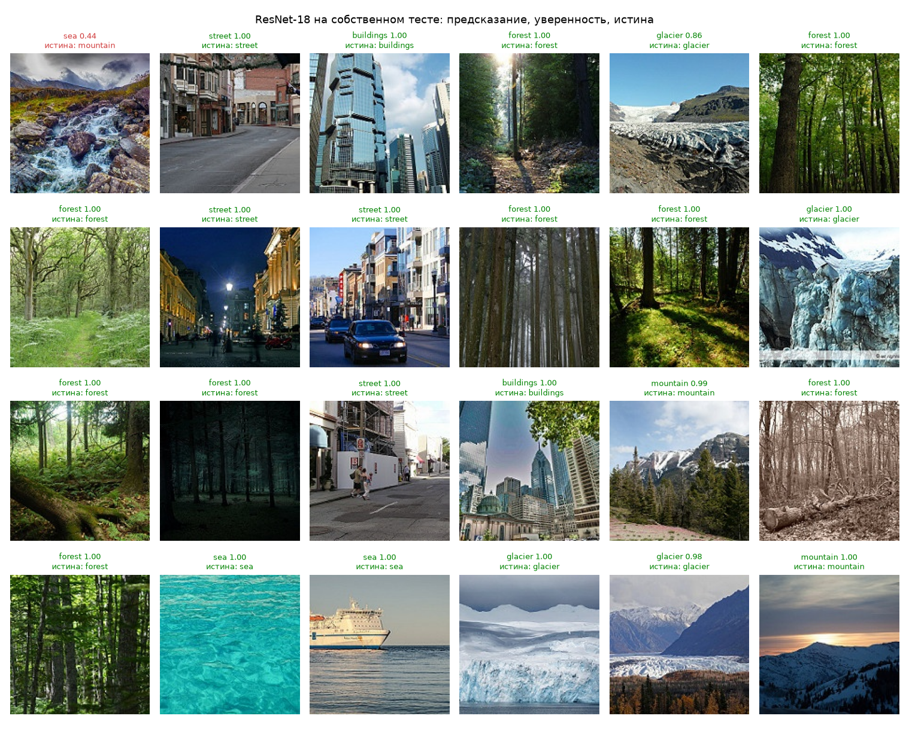
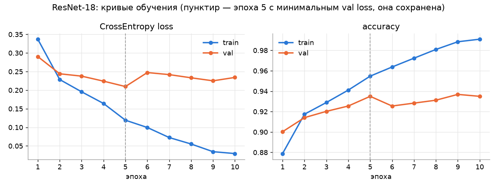
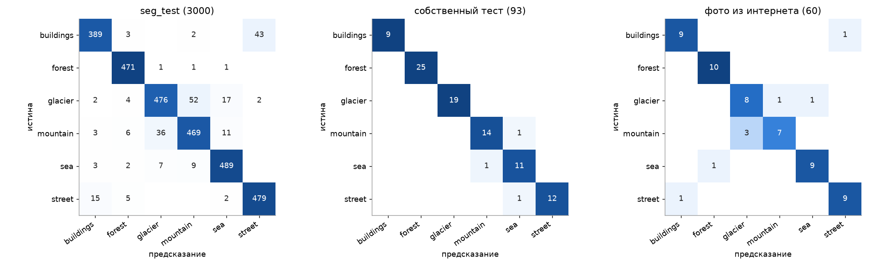
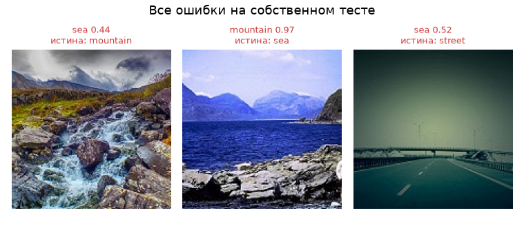
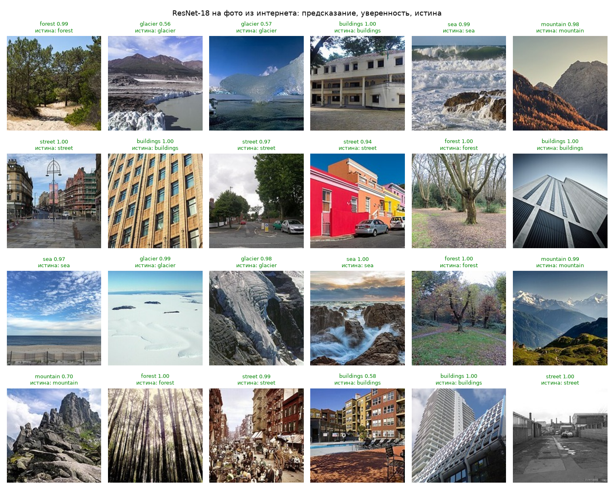
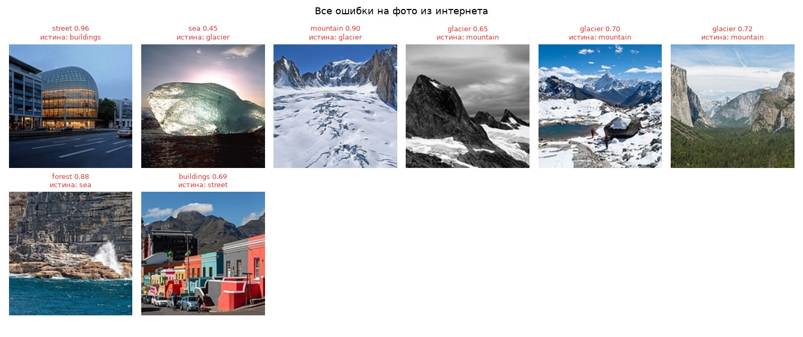

# Лабораторная работа №3. Классификация изображений сверточной нейросетью

**Цель:** научиться создавать простые системы классификации изображений на основе сверточных нейронных сетей.

**Задача:** классификация природных и городских сцен по 6 классам: `buildings` (здания), `forest` (лес), `glacier` (ледник), `mountain` (горы), `sea` (море), `street` (улица). Такой классификатор может, например, автоматически раскладывать фотографии из путешествий по тегам.



## 1. Теоретическая база

**Сверточная нейронная сеть (CNN)** [1] обрабатывает изображение каскадом слоёв, каждый из которых сохраняет пространственную структуру входа:

* **Свёртка** — набор обучаемых фильтров $k \times k$, которые скользят по изображению: $y_{c'}(i,j) = b_{c'} + \sum_{c}\sum_{u,v} w_{c',c}(u,v)\, x_c(i+u, j+v)$. Фильтр с одними и теми же весами применяется во всех точках, поэтому параметров мало, а найденный признак (край, текстура) распознаётся в любом месте кадра.
* **Нелинейность** ReLU $\max(0, x)$ — без неё стопка свёрток была бы одной линейной операцией.
* **Пулинг** (max pooling 2×2) уменьшает разрешение вдвое. Следующие свёртки видят всё большую область исходного изображения (рецептивное поле растёт), и признаки становятся всё более абстрактными: края → текстуры → части объектов → сцены.
* **Batch Normalization** [2] нормирует активации по батчу, что стабилизирует и ускоряет обучение.
* **Голова классификатора**: global average pooling усредняет каждую карту признаков в одно число, затем полносвязный слой выдаёт логиты $z_k$ по классам; softmax переводит их в вероятности $p_k = e^{z_k} / \sum_j e^{z_j}$.

**Функция потерь** — перекрёстная энтропия $L = -\log p_{y}$, где $y$ — правильный класс. Она штрафует модель тем сильнее, чем меньше вероятность, отданная правильному ответу. Веса обновляются градиентным спуском (здесь — AdamW [3], Adam с отделённым weight decay), градиенты считаются обратным распространением ошибки.

**ResNet** [4] — глубокая CNN из остаточных блоков $y = F(x) + x$: блок учит только поправку к входу, а «короткое замыкание» пропускает градиент напрямую, поэтому сети из десятков слоёв обучаются без затухания градиента.

**Перенос обучения (transfer learning)** [5]. Сеть, обученная на ImageNet (1,2 млн изображений, 1000 классов), уже умеет извлекать универсальные признаки. Достаточно заменить последний слой под свои классы и дообучить всю сеть с небольшим learning rate (fine-tuning). Это даёт высокую точность при небольшом датасете и малом числе эпох.

**Переобучение** — модель запоминает обучающую выборку вместо общих закономерностей: ошибка на train продолжает падать, а на валидации растёт. Признак переобучения — расходящиеся кривые train/val loss. Методы борьбы, использованные в работе: аугментации (случайные кропы, отражения, изменение яркости/контраста — модель каждую эпоху видит немного другие картинки), weight decay, ранняя остановка (сохраняется модель с минимальной val loss).

**Метрики.** *Accuracy* — доля правильных ответов. *Macro-F1* — среднее по классам от $F_1 = 2PR/(P+R)$, где $P$ — точность (precision), $R$ — полнота (recall); в отличие от accuracy, не позволяет хорошо выглядеть за счёт крупных классов, что важно для несбалансированного собственного теста. *Матрица ошибок* показывает, какие классы путаются между собой.

## 2. Описание системы

### Данные

| Выборка | Откуда | Размер | Назначение |
|---|---|---|---|
| train | [Intel Image Classification](https://www.kaggle.com/datasets/puneet6060/intel-image-classification) [6], `seg_train`, 85% | 11 928 | обучение |
| val | `seg_train`, 15%, стратифицированно, `seed=42` | 2 106 | выбор эпохи, контроль переобучения |
| seg_test | `seg_test` из того же датасета | 3 000 | независимая проверка |
| **собственный тест** | вручную размечено из неразмеченной папки `seg_pred` | **93** | итоговая проверка |
| **фото из интернета** | собрано с Wikimedia Commons и размечено вручную | **60** | проверка на данных не из датасета |

Изображения 150×150 пикселей. Собственный тест: из 7 301 неразмеченного изображения `seg_pred` случайно (`seed=0`) выбраны 96 и размечены вручную. Три неоднозначных изображения исключены (цветы на склоне, вода крупным планом, озеро на фоне гор), осталось 93: forest 25, glacier 19, mountain 15, street 13, sea 12, buildings 9. Изображения лежат в [data/custom_test/](data/custom_test/), разметка — в [labels.csv](data/custom_test/labels.csv).

Фото из интернета: по каждому классу через API Wikimedia Commons найдено 24 кандидата (по 3 поисковых запроса на класс), всего 144. Каждое фото просмотрено и размечено вручную, поисковому запросу метка не доверялась. Отброшены рисунки и гравюры, спутниковые и космические снимки, интерьеры, дубликаты и неоднозначные кадры (фасады с уличными кафе, горы за песчаными дюнами, город на фоне гор). Осталось ровно по 10 на класс. Фото обрезаны до квадрата по центру и уменьшены до 150×150, как в датасете. Изображения лежат в [data/web_test/](data/web_test/), а в [sources.csv](data/web_test/sources.csv) для каждого указаны метка, ссылка на источник и лицензия (все свободные: CC BY / CC BY-SA / CC0 / public domain).

### Зафиксированные архитектура, loss и метрики

| | |
|---|---|
| Архитектура | **ResNet-18** [4], предобученная на ImageNet (`IMAGENET1K_V1`), последний слой `fc` заменён на `Linear(512, 6)`; 11,2 млн параметров |
| Способ обучения | fine-tuning всей сети (дообучаются все слои, не только голова) |
| Loss | CrossEntropy |
| Оптимизатор | AdamW, lr 3·10⁻⁴, weight decay 10⁻⁴, косинусное убывание lr, 10 эпох, батч 64 |
| Аугментации | `RandomResizedCrop(150, scale=(0.6, 1))`, горизонтальное отражение, `ColorJitter(0.2, 0.2, 0.2)` |
| Ранняя остановка | после каждой эпохи считается val loss, сохраняются веса с минимальной val loss |
| Метрики | accuracy, macro-F1, матрица ошибок |

```
изображение 3×150×150
  │  Resize 150×150, нормализация по статистике ImageNet (+ аугментации при обучении)
  ▼
conv1 7×7 / 2 + maxpool          → 64×38×38
  ▼
layer1..layer4 (по 2 остаточных   → 512×5×5      признаки, перенесённые с ImageNet
блока, stride 2 в layer2-4)                       и дообученные на сценах
  ▼
Global Average Pooling            → 512
  ▼
Linear(512, 6) → softmax          → класс + уверенность
```

| Файл | Что делает |
|---|---|
| [data.py](data.py) | пути, классы, трансформации, разбиение train/val, загрузчики |
| [models.py](models.py) | ResNet-18 с новой головой на 6 классов |
| [train.py](train.py) | обучение, история метрик по эпохам, сохранение лучшей модели |
| [evaluate.py](evaluate.py) | метрики на val / seg_test / собственном тесте, графики в `results/` |

### Системные требования

Python ≥ 3.14, PyTorch 2.14, torchvision 0.29, scikit-learn, matplotlib (зависимости — в `pyproject.toml` в корне репозитория). Обучение выполнялось на MacBook (Apple M4, 16 ГБ) через бэкенд MPS; код сам выбирает MPS, CUDA или CPU. Одна эпоха занимает ~80 с, всё обучение — ~13 мин. Для работы нужно около 1 ГБ на диске под датасет.

### Запуск

```bash
# датасет с Kaggle распаковать в Lab3/data/intel (seg_train/, seg_test/, seg_pred/)
unzip archive.zip -d Lab3/data/intel
cd Lab3
uv run train.py                # обучение, веса в checkpoints/resnet18.pt
uv run evaluate.py             # таблица метрик и графики в results/
```

## 3. Результаты

### Кривые обучения



| Эпоха | train loss | train acc | val loss | val acc |
|---|---|---|---|---|
| 1 | 0.337 | 0.879 | 0.290 | 0.900 |
| 2 | 0.229 | 0.917 | 0.244 | 0.914 |
| 3 | 0.196 | 0.929 | 0.238 | 0.920 |
| 4 | 0.164 | 0.941 | 0.224 | 0.925 |
| **5** | **0.119** | **0.955** | **0.210** | **0.935** |
| 6 | 0.100 | 0.964 | 0.247 | 0.925 |
| 7 | 0.073 | 0.972 | 0.242 | 0.928 |
| 8 | 0.055 | 0.981 | 0.233 | 0.931 |
| 9 | 0.035 | 0.988 | 0.225 | 0.937 |
| 10 | 0.029 | 0.991 | 0.234 | 0.935 |

Train-метрики здесь посчитаны по ходу эпохи на аугментированных изображениях.

**Переобучилась ли модель.** Первые 5 эпох обе кривые loss идут вниз, модель учит общие закономерности. После 5-й эпохи train loss продолжает падать (0.119 → 0.029, в 4 раза), а val loss перестаёт улучшаться и колеблется около 0.23–0.25, выше минимума 0.210. Val accuracy при этом стоит на месте (~0.93). Это начало переобучения: сеть всё увереннее запоминает обучающие картинки, но на новых данных лучше не становится. Сильного переобучения нет: val loss не растёт неограниченно, а val accuracy не падает. Благодаря ранней остановке сохранены веса 5-й эпохи, все дальнейшие метрики — для них.

### Метрики на всех выборках

| Выборка | Изображений | Accuracy | Macro-F1 |
|---|---|---|---|
| train (без аугментаций) | 11 928 | 0.973 | 0.973 |
| val (15% seg_train) | 2 106 | 0.935 | 0.935 |
| seg_test | 3 000 | 0.924 | 0.925 |
| **собственный тест** | **93** | **0.968** | **0.962** |
| **фото из интернета** | **60** | **0.867** | **0.865** |

Разрыв train/val составляет 3,8 п.п., а val и независимый seg_test почти совпадают (0.935 и 0.924). Значит, оценка на валидации не завышена и модель обобщается на новые данные.

### Матрицы ошибок



Качество по классам на seg_test:

| Класс | Precision | Recall | F1 |
|---|---|---|---|
| buildings | 0.944 | 0.890 | 0.916 |
| forest | 0.959 | 0.994 | 0.976 |
| glacier | 0.915 | 0.861 | 0.887 |
| mountain | 0.880 | 0.893 | 0.887 |
| sea | 0.940 | 0.959 | 0.950 |
| street | 0.914 | 0.956 | 0.935 |

Закономерности:

* Почти все ошибки приходятся на две пары визуально близких классов: **glacier ↔ mountain** (52 + 36 ошибок) и **buildings ↔ street** (43 + 15). Заснеженные горы почти всегда видны на фото ледника, а на фото улицы почти всегда есть здания. Часть таких изображений неоднозначна и для человека: в датасете кадр относится к одному классу, хотя на нём есть оба.
* **forest** распознаётся почти идеально (recall 0.994): у леса уникальная текстура и цвет, его не с чем спутать.
* Третий источник ошибок — **sea** с горами или ледниками на заднем плане (sea ↔ mountain/glacier).

### Собственный тест


На 93 размеченных вручную изображениях 90 правильных (accuracy 0.968). Ошибок всего три:



1. Горный ручей с камнями, горы в тумане → `sea` (0.44): вода на переднем плане перевешивает, уверенность низкая.
2. Море с горами на заднем плане → `mountain` (0.97): та же путаница sea/mountain, что и на seg_test.
3. Тёмное тонированное фото шоссе с туманным небом → `sea` (0.52): однородная сине-зелёная гамма похожа на воду.

В двух случаях из трёх уверенность модели ниже 0.55, а на правильных ответах она почти всегда 0.98–1.00. По уверенности можно отсеивать сомнительные предсказания.

Accuracy на собственном тесте выше, чем на seg_test (0.968 против 0.924). Скорее всего, это потому, что при разметке три самых неоднозначных изображения были исключены, а в seg_test такие спорные кадры остаются. На 93 изображениях одна ошибка меняет accuracy на ~1 п.п., так что разница в пределах статистического шума.

### Фото из интернета



На 60 фото с Wikimedia Commons модель ответила правильно на 52 (accuracy 0.867, macro-F1 0.865). Это на 6–10 п.п. ниже, чем на изображениях самого датасета: это **сдвиг домена** (domain shift). Фото из интернета сняты другими камерами и в другом стиле, среди них больше художественных кадров (ч/б, контровой свет, необычные ракурсы), а при обрезке до квадрата часть сцены теряется.



| Класс | Precision | Recall | F1 |
|---|---|---|---|
| buildings | 0.900 | 0.900 | 0.900 |
| forest | 0.909 | 1.000 | 0.952 |
| glacier | 0.727 | 0.800 | 0.762 |
| mountain | 0.875 | 0.700 | 0.778 |
| sea | 0.900 | 0.900 | 0.900 |
| street | 0.900 | 0.900 | 0.900 |

* Самая частая ошибка та же, что на seg_test: **mountain → glacier** (3 из 8). Все три — горы с большими полями снега. В датасете «много снега на переднем плане» чаще означает ледник, и модель выучила эту корреляцию. Обратная ошибка: снежное плато ледника под пиками Монблана распознано как `mountain` (0.90).
* Айсберг в контровом свете над тёмной водой распознан как `sea` с низкой уверенностью 0.45. Таких кадров в датасете почти нет.
* Скалы с брызгами прибоя распознаны как `forest`. Рыжая слоистая стена скал по текстуре похожа на стволы и кору.
* Здание со стеклянным куполом и дорогой на переднем плане → `street`. Цветные дома Бо-Каапа с машинами → `buildings`. Это обычная путаница buildings ↔ street.
* `forest` и здесь распознаётся безошибочно (recall 1.0).

## 4. Выводы

1. Построена система классификации сцен на 6 классов: ResNet-18, предобученная на ImageNet и дообученная на датасете Intel Image Classification. Обучение заняло 10 эпох (~13 минут на Apple M4).
2. Итоговое качество: accuracy **0.935** на валидации, **0.924** на независимом seg_test (3 000 изображений) **0.968** на собственной вручную размеченной выборке из `seg_pred` (93 изображения) и **0.867** на 60 вручную собранных и размеченных фото из интернета.
3. Перенос обучения очень эффективен: уже после первой эпохи точность 90%, потому что признаки ImageNet (текстуры, формы, цвета) хорошо подходят для распознавания сцен.
4. После 5-й эпохи появляются признаки переобучения: train loss падает дальше, а val loss — нет. Ранняя остановка по val loss выбрала эпоху 5. Итоговый разрыв train/val (0.973 и 0.935) умеренный, а val и seg_test согласуются, так что модель не переобучена.
5. На фото не из датасета качество ниже (0.867 против 0.924): сказывается сдвиг домена. Модель частично опирается на особенности самого датасета, например «много снега = ледник». Для работы с произвольными фото нужно добавлять в обучение более разнообразные данные.
6. Основные ошибки — путаница семантически пересекающихся классов (glacier/mountain, buildings/street, sea с горами на фоне). Это ограничение не столько модели, сколько постановки: у такой сцены нет одной верной метки. Улучшить можно multi-label разметкой, более высоким разрешением (224 px) или ансамблем моделей.

## 5. Использованные источники

1. LeCun Y., Bottou L., Bengio Y., Haffner P. Gradient-based learning applied to document recognition // Proc. IEEE. 1998. Vol. 86, № 11. P. 2278–2324.
2. Ioffe S., Szegedy C. Batch Normalization: Accelerating Deep Network Training by Reducing Internal Covariate Shift // ICML. 2015.
3. Loshchilov I., Hutter F. Decoupled Weight Decay Regularization // ICLR. 2019.
4. He K., Zhang X., Ren S., Sun J. Deep Residual Learning for Image Recognition // CVPR. 2016.
5. Yosinski J., Clune J., Bengio Y., Lipson H. How transferable are features in deep neural networks? // NeurIPS. 2014.
6. Intel Image Classification. Kaggle. URL: https://www.kaggle.com/datasets/puneet6060/intel-image-classification
7. Goodfellow I., Bengio Y., Courville A. Deep Learning. MIT Press, 2016. Гл. 7 (регуляризация), гл. 9 (сверточные сети).
8. PyTorch Tutorials: Transfer Learning for Computer Vision. URL: https://pytorch.org/tutorials/beginner/transfer_learning_tutorial.html
